  

  

  
  
  
  

### 👾 About me

- 🛠️ **AI Engineer at [FAIR](https://simar00316.github.io/#work)** (Football AI and Research). I lead a production LangGraph multi-agent platform.
- 📈 Made it cheaper, faster and more correct at once: **text-to-SQL accuracy 67% → 87%** on an eval suite, **LLM cost −40–50%**, **6–7 s faster** per query, **cloud spend −57%**.
- 🚀 I take AI products **from idea to production**: architecture, agents, evals, backend, UI and deployment.
- 💼 **Open for freelance work:** AI chatbots on your data, AI agents and automation, chat-with-your-database, and AI MVPs. [Start a project →](https://www.upwork.com/freelancers/~01c66ee925ab3899d3)

### ✨ Featured projects

| Project | What it is | Stack |
|---|---|---|
| **[AgentDesk](https://github.com/Simar00316/AgentDesk)** | No-code, multi-tenant AI agent builder deployed to WhatsApp and APIs. A LangGraph router over hybrid RAG, AST-validated read-only text-to-SQL and web search, with guardrails, RBAC and evals. | Python · FastAPI · LangGraph · Next.js · Qdrant |
| **[rA.nous](https://github.com/Simar00316/ra-nous)** | Long-term memory for AI agents: a Neo4j knowledge graph plus Qdrant vectors with sub-200 ms retrieval, served through an MCP server, an OpenAI-compatible proxy and a REST API. | Python · FastAPI · Neo4j · Qdrant · Redis · MCP |
| **[sudo-get-a-job](https://github.com/Simar00316/sudo-get-a-job)** | Agent skill + CLI that lets Claude Code drive a real browser to fill job applications, using ~100-token page views instead of ~1,500-token screenshots. | Python · Chrome DevTools Protocol · Claude Code |

### 🧰 Stack

  

**AI:** LangGraph · LangChain · LlamaIndex · OpenAI · Claude · Gemini · MCP · RAG · text-to-SQL · LLM-as-judge evals · LangSmith 
**Data:** Qdrant · Pinecone · Neo4j · PostgreSQL · MongoDB · Redis

### 📊 Languages

  

Have an AI idea or a broken prototype? <a href="https://simar00316.github.io">Let's build it →</a>

